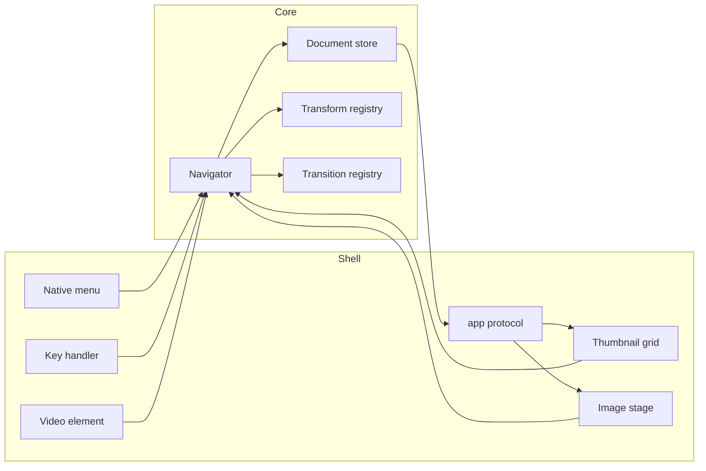

# Image Viewer

This document is the specification for a macOS image and video viewer. It is enough to implement the application in a new repository. No other project, bundler, or disk-image tool is required.

The application is one Rust crate. The UI is Dioxus 0.8 desktop:

```toml
dioxus = { version = "0.8.0-alpha.3", features = ["desktop"] }
```

That feature draws the virtual DOM in `WKWebView` (wry and tao). The web view is part of macOS. The app does not ship Qt, a browser engine, Python, Pillow, or OpenCV.

## 1. Behaviour

One window, two modes. The browser lists a folder. The viewer shows one image or one video from that folder.

### Startup

The window opens at origin (300, 100), size 1024×768, minimum size 1024×768, decorated and resizable. Escape quits, unless a dialog is open. A dialog consumes Escape and cancels. Double-click toggles fullscreen only while a file is open.

Which folder appears is decided from the launch Apple Event. There is no timer. macOS starts an app with one of two events:

- `oapp` (open application). Nothing is being opened. List `~/Pictures`, or the home directory if Pictures does not exist.
- `odoc` (open documents). Finder, or `open`, is handing over files. tao's `Event::Opened` carries the URLs. Show the first file, with its parent loaded in the browser. Extra URLs in that event are ignored.

`platform/launch.rs` reads the current event once, on the first event-loop callback, from `NSAppleEventManager`. The class is `aevt` (`0x61657674`). The id is `oapp` (`0x6f617070`) or `odoc` (`0x6f646f63`).

`currentAppleEvent` is set only while that event is being dispatched. If it is already nil, do not wait on the clock. Schedule the startup folder as a block on the next turn of the main queue (`dispatch_async`). An `Opened` event already queued at launch runs before that block, and the block then does nothing. That is the same ordering Cocoa uses, without a 150 ms guess that can lose the race on a slow launch or flash the wrong folder on a fast one.

A single command-line path is used only for an `oapp` launch, or when the event could not be read and no `Opened` event arrived before the next turn. An `odoc` launch wins over the command line, because that is the Finder launch.

An `Opened` event after the app is already running opens that file immediately.

A path is opened whether or not it contains `.vscode`. Do not special-case editor paths.

### Browser

- Eight equal columns. The thumbnail's CSS size is the content width divided by eight. The decoded bitmap is that size times the web view device-pixel ratio.
- Entries, in order:
  1. The parent directory, omitted when its path equals the current path (the filesystem root).
  2. Other child directories whose names do not start with `.`, sorted by name, case-insensitive.
  3. Child files with a supported suffix, sorted by name, case-insensitive. A file whose name starts with `.` is included when the suffix matches.
- The label is the path stem (no suffix), elided in the middle to the cell width. The parent entry is labelled with the parent directory's name, not `..`.
- Directories use `folder.png`. Videos use `video.png`. Images show `loading.png` at 20% opacity until the decode finishes, then the thumbnail at full opacity.
- One highlight. Arrow keys move it by one cell or by one row of eight, clamped to the list, and scroll it into view. Return or a click opens it.
- Opening a directory remembers the highlight index and scroll offset for the folder being left, then lists the new folder. Returning restores both after the grid has been committed. If the index is now out of range, clamp it.
- The window title is the current directory's stem.
- Leaving a folder discards in-flight thumbnail results. Decode work must not touch UI state; the UI thread applies a finished bitmap.

### Viewer

Supported files:

| Kind | Suffixes |
| --- | --- |
| Image | `.gif` `.jpg` `.jpeg` `.png` `.webp` |
| Video | `.mp4` `.mov` |

Suffix checks are case-insensitive.

A GIF or WebP with more than one frame is an animation and plays in the viewer. Anything else is a still image. The grid does not animate: a thumbnail is the first composited frame.

Decode GIF frames with `image::codecs::gif::GifDecoder`. Decode animated WebP with `image-webp`, because `image`'s WebP path only returns the first frame. Composite every frame onto the full canvas (the GIF logical screen, or the WebP VP8X canvas) before display or editing.

GIF disposal, applied after the frame has been shown:

- Unspecified or do-not-dispose (0 or 1): leave the pixels.
- Background (2): clear that frame's rectangle to transparent.
- Previous (3): restore the canvas to the snapshot taken before the frame was drawn.

WebP ANMF frames carry an offset, a duration, a blend flag, and a dispose flag. Blend composites the frame over the canvas; no-blend replaces the rectangle. Dispose-to-background clears that rectangle to transparent after the frame; otherwise the pixels stay.

Delays follow the usual browser rule so a zero delay does not spin:

- GIF delay is in centiseconds. A stored delay of 0 or 1 is shown for 100 ms. Any other value is `centiseconds * 10` ms.
- WebP duration is in milliseconds. 0 is shown for 100 ms.

Loop count:

- GIF with no Netscape loop extension plays once. A Netscape count of 0 repeats forever. A count of N plays N times.
- WebP ANIM count 0 repeats forever. A count of N plays N times.

Playback starts when the image opens. Space pauses and resumes. The clock stops when the viewer leaves the file. Zoom, pan, and selection belong to the viewport, so they stay put across frames. Selection and crop use canvas pixels and the same rectangle on every frame.

A committed edit, including crop, runs on every composited frame and keeps the delays, the loop count, and the canvas size. The adjust dialog previews the frame that is currently showing, and OK applies those factors to every frame as one undo step. Undo stores the previous frame list, still capped at 16 lists.

If the composited frames of one document would exceed 256 MiB, or a transform would push them over that, do not animate and do not apply the transform. Log a warning, keep the first frame as a still when the file itself is over the limit, and leave the document unchanged when a transform would cross it.

An edited animation is saved as an animated GIF. The pure-Rust WebP encoder writes a single frame, so an edited animated WebP is saved as GIF too. The original file is not rewritten, and an unedited WebP still plays as WebP. A still image is saved as PNG.

Images are fitted to the window, aspect preserved. The scroll wheel multiplies the zoom by 1.05 or divides by 1.05, keeping the image point under the pointer fixed. Primary-button drag pans. A resize while still fitted only refits. A resize after the user has zoomed keeps the image point that was in the centre of the viewport in the centre.

Control-drag (the Control key, not Command) draws a selection in image pixels. The overlay is `rgb(30, 144, 255)` at 50% alpha with a solid blue border, clipped to the image. A primary click without Control clears it. Zoom to Rect frames that rectangle, aspect preserved, and leaves fitted mode. Crop to Rect commits the clamped pixel rectangle and clears the selection. Reset Zoom fits the image again. Any committed edit also returns to fit and clears the selection.

Left and Right move through the supported files in the current folder and wrap. Up returns to the browser. The title becomes `{folder stem} - {file stem}`.

Edits push the previous frame list on an undo stack capped at 16. The oldest entry is dropped past that. Undo pops. The document is dirty when the current frame list is not the list that was last saved (or the list loaded from disk, if it has never been saved). The title gains a trailing ` *` while it is dirty. A successful save clears that: Save becomes disabled, and the star comes off the title. Undo stays available. Undoing back onto the saved list clears the star again. Undoing past it, or making another edit, sets the star again.

Save, while the document is dirty, writes a new file next to the source. A still image is a PNG. An animation is an animated GIF, including when the source was an animated WebP.

```text
{stem} - Modified {yy-mm-dd HH.MM.SS}.png
{stem} - Modified {yy-mm-dd HH.MM.SS}.gif
```

The timestamp is local time. Example: `Holiday - Modified 26-10-18 14.03.09.png`.

Image Information lists Format, Format Description, Width, Height, and Mode. Descriptions are `JPEG (ISO 10918)`, `Portable network graphics`, `GIF (Graphics Interchange Format)`, and `WebP`. Mode is the file's mode before conversion to RGBA (`RGB`, `RGBA`, `L`, `P`, and so on). An animation also lists Frame Count, Loop (`Once`, `Forever`, or the count), and Duration, which is the sum of the display delays in seconds to one decimal place.

Adjust Image is a dialog with Colour, Contrast, and Brightness sliders. Each runs from 0 to 20 and is divided by 10, so 10 is factor 1.0. Movement previews without touching the undo stack. OK commits the three adjustments as one undo step. Cancel restores the pre-dialog image. Escape cancels.

Videos loop. Space pauses and resumes. Shift-Left and Shift-Right seek by 5 seconds. Shift-Up and Shift-Down change volume by 0.1, clamped to 0.0–1.0, and unmute. Shift-M toggles mute. Volume starts at 1.0. A scrubber is inset 100 px from the left, right, and bottom of the view, 4 px tall, Dodger Blue at 50% alpha, with a white position mark. Pointer movement and skip commands show it and hide it 500 ms after the pointer stops. A click seeks to that fraction of the duration. Returning to the browser or opening another file stops playback.

Image commands are enabled for an open image, including an animation. Video commands other than Play / Pause are enabled only for a video. Play / Pause is enabled for a video or an animated image. File, Show, Image, and Video menus are enabled only while a file is open. A disabled command does not receive its shortcut, which is what keeps Shift-Left and Shift-Right from meaning both "colour" and "seek" at once.

### Shortcuts

These are physical Mac keys. Command is the modifier Dioxus calls Meta. Option is Alt. Control is Control. Do not swap Control and Command the way Qt did.

| Action | Keys | Enabled when |
| --- | --- | --- |
| Save | Command-S | Image is dirty |
| Return to browser | Up | A file is open |
| Next / Previous | Right / Left | A file is open |
| Adjust Image | Control-A | Image |
| Zoom to Rect | Control-Z | Image or video, and a selection exists |
| Reset Zoom | Control-R | Zoomed |
| Image Information | Command-I | Image |
| Crop to Rect | Control-C | Image and a selection exists |
| Increase / Decrease Colour | Shift-Right / Shift-Left | Image |
| Increase / Decrease Contrast | Option-Right / Option-Left | Image |
| Increase / Decrease Brightness | Command-Right / Command-Left | Image |
| Black and White | Option-W | Image |
| Sharpen, Blur, Contour, Detail | Option-S, B, C, D | Image |
| Edge Enhance, Emboss, Find Edges | Option-E, M, F | Image |
| Smooth, Unsharp Mask, Auto Contrast, Denoise | Option-O, U, A, N | Image |
| Super Resolution | Control-S | Image |
| Undo | Command-Z | Image undo stack is non-empty |
| Play / Pause | Space | Video, or an animated image |
| Skip | Shift-Right / Shift-Left | Video |
| Volume | Shift-Up / Shift-Down | Video |
| Mute | Shift-M | Video |
| Quit | Escape | No dialog is open |

Colour, contrast, and brightness keyboard steps use factors 1.1 and 0.9. Super Resolution requests scale 4. Black and White is colour at factor 0.

### Constants

| Name | Value |
| --- | --- |
| Highlight and selection | `rgb(30, 144, 255)`, overlays at alpha 0.5 |
| Zoom step | 1.05 |
| Undo cap | 16 |
| Video skip | 5 000 ms |
| Volume step | 0.1 |
| Scrubber inset | 100 px |
| Scrubber thickness | 4 px |
| Scrubber hide delay | 500 ms |
| Animation size limit | 256 MiB of composited frames for one document |
| GIF short delay | Stored 0 or 1 centiseconds displays as 100 ms |
| Slider domain | 0–20, divided by 10 |

## 2. Goals and non-goals

**Goals**

- The behaviour in section 1.
- A native `.app` installed to `/Applications` by `scripts/install-app.sh`.
- A stable bundle identifier, `local.image-viewer`, so a network permission grant survives rebuilds.
- Finder Open With and double-click for the suffixes in section 1.
- A new image transform is one trait implementation added to a registry. The Image menu and the shortcut map are built from that registry.
- A new image transition is one trait implementation added to a registry. Next, Previous, and Open go through a single navigator that consults it. The only shipped transition is an instant cut.
- Canonical pixels stay in Rust. The web view receives encoded frames through an `app://` protocol.

**Non-goals**

- Windows and Linux.
- The Mac App Sandbox, a hardened runtime, an entitlements file, notarization, or a disk image. A Developer ID or Apple Development certificate is used when one is already in the keychain. Obtaining a certificate is not part of this project.
- `dx bundle`, `cargo-bundle`, or any other app bundler. The shell script assembles the bundle.
- A preferences window, redo, HEIC, or a URL bar.
- Writing an edited animation back out as animated WebP. Playback of animated WebP is supported. A saved edit of an animation is an animated GIF.
- Bit-identical output with OpenCV for denoise and FSRCNN. Those two stay behind the transform trait. Kernel filters and the enhancers are specified exactly.

## 3. Technology

| Concern | Choice |
| --- | --- |
| UI | Dioxus 0.8.0-alpha.3, feature `desktop` |
| Window, menus, open-document events | tao and muda, re-exported by `dioxus::desktop` |
| Launch | `dioxus::LaunchBuilder::desktop()` |
| Still images and GIF animation | `image` 0.25, features `jpeg`, `png`, `gif`, `webp`, default features off |
| Animated WebP decode | `image-webp` 0.2 |
| Resize | `fast_image_resize` 5 |
| Kernels and enhancers | This crate, as specified below |
| Denoise | This crate, non-local means in CIELAB |
| Super-resolution | ONNX files inferred with `tract-onnx`. Isolated in one module |
| Video | A `<video>` element. The file is served by the custom protocol with HTTP range support |
| Logging | `tracing` into one size-rotated file via `file-rotate` |
| Blocking work | `spawn_blocking` on the tokio runtime dioxus-desktop already starts |

Denoise and a 4× upscale must not run on the UI thread. The web view shares that thread.

`tract-onnx` is the inference library so the shipped app has no OpenCV. If a 4× upscale is too slow, only `transforms/super_resolution.rs` changes. The menu, undo stack, and document type stay as they are.

## 4. Repository

A single package at the repository root. Edition 2021. `rust-version` is `1.85`.

```text
Cargo.toml
Cargo.lock
assets/
    AppIcon.png          1024×1024 PNG, RGBA. Required by the icon script
    folder.png           square PNG, at least 256×256
    loading.png
    video.png
    models/
        fsrcnn_x2.onnx   may be absent until conversion; the app still builds
        fsrcnn_x3.onnx
        fsrcnn_x4.onnx
        README.md        tensor names, layout, and value range from conversion
scripts/
    make-app-icon.sh
    install-app.sh
src/
    main.rs
    app.rs
    command.rs
    state.rs
    catalog.rs
    document.rs
    viewport.rs
    protocol.rs
    resources.rs
    browser/
        mod.rs
        thumbnail.rs
    viewer/
        mod.rs
        stage.rs
        video.rs
    transforms/
        mod.rs
        kernels.rs
        enhance.rs
        denoise.rs
        super_resolution.rs
    transitions/
        mod.rs
    dialogs/
        adjust.rs
        info.rs
    platform/
        menu.rs
        launch.rs
tests/
    fixtures/
```

`platform/` is the only module that names macOS windowing types. Transforms do not import Dioxus.

```toml
[package]
name = "image-viewer"
version = "0.1.0"
edition = "2021"
rust-version = "1.85"
authors = ["Steve"]
description = "Browse, view, and edit images and videos"

[dependencies]
dioxus = { version = "0.8.0-alpha.3", features = ["desktop"] }
image = { version = "0.25", default-features = false, features = ["jpeg", "png", "gif", "webp"] }
image-webp = "0.2"
fast_image_resize = "5"
tracing = "0.1"
tracing-subscriber = "0.3"
file-rotate = "0.8"
```

Add `tract-onnx` when the super-resolution module is written. Do not add a `[package.metadata.bundle]` table and do not add a `Dioxus.toml`. Nothing reads them.

### Launch

```rust
use dioxus::desktop::{LogicalPosition, LogicalSize, WindowBuilder};

fn main() {
    let window = WindowBuilder::new()
        .with_title("Image Viewer")
        .with_inner_size(LogicalSize::new(1024.0, 768.0))
        .with_min_inner_size(LogicalSize::new(1024.0, 768.0))
        .with_position(LogicalPosition::new(300.0, 100.0));

    let cfg = dioxus::desktop::Config::new()
        .with_window(window)
        .with_menu(platform::menu::native_menu())
        .with_disable_context_menu(true)
        .with_asynchronous_custom_protocol("app", protocol::handle)
        .with_custom_event_handler(platform::launch::on_tao_event);

    dioxus::LaunchBuilder::desktop().with_cfg(cfg).launch(app::app);
}
```

`on_tao_event` handles tao's opened-document event (`Event::Opened { urls }` in tao 0.37, which this Dioxus release uses) and applies the startup rule in section 1. Confirm the variant against the re-exported `dioxus::desktop::tao` if the compiler rejects the name. `NSAppleEventManager` is not in the pregenerated `objc2-foundation` bindings, so the two messages (`sharedAppleEventManager`, `currentAppleEvent`) and `eventClass` / `eventID` are sent with `objc2`, which dioxus-desktop already links. The deferred startup-folder block uses `dispatch_async` on the main queue.

There is no HTML file-drop handler.

### Resources

Browser icons and models are files. The About-menu icon is `include_bytes!("../assets/AppIcon.png")`, decoded with `image` and resized to 256×256 for `muda::Icon::from_rgba`.

```rust
pub fn resources_dir() -> std::path::PathBuf {
    if let Ok(exe) = std::env::current_exe() {
        // Image Viewer.app/Contents/MacOS/image-viewer -> Contents/Resources
        if let Some(resources) = exe.parent().and_then(|p| p.parent()).map(|p| p.join("Resources")) {
            if resources.is_dir() {
                return resources;
            }
        }
    }
    std::path::PathBuf::from(env!("CARGO_MANIFEST_DIR")).join("assets")
}
```

`cargo run` therefore reads `assets/`. The installed app reads `Contents/Resources/`. Models live in `models/` under that directory.

### Logging

One log, in the place Console.app already looks:

```text
~/Library/Logs/ImageViewer/ImageViewer.log
```

Create the directory if it is missing. `file-rotate` rotates that file when it passes 1 MiB, keeps four older files (`ImageViewer.log.1` through `ImageViewer.log.4`), and deletes anything beyond those. A new launch appends. It does not create another file. The `tracing-subscriber` fmt layer writes plain text (no ANSI colour) at info, with a timestamp, the level, and the message.

Decode, transform, and save failures are logged and shown in the window. A corrupt file is a cell or stage message, not a panic. Crossing the animation size limit is logged.

## 5. Architecture

Two layers:

1. **Core.** Catalog, documents, viewport math, transforms, transitions, undo, and save. No Dioxus imports. Unit-tested on the host.
2. **Shell.** Components, the native menu, the protocol, the video element, and launch events. The shell sends commands and draws what the core returns.



Rust holds the frame list behind `Arc`. A generation counter increases when that list changes. The stage requests `app://image/current?g={generation}&f={frame}`. Zoom and pan are CSS transforms, so a new frame does not reset the view and the wheel does not re-encode.

### State

One `Signal<AppState>`, mutated in place. Replacing the zoom clones an `Arc`, not the pixels.

```rust
struct AppState {
    mode: Mode,
    folder: FolderView,
    history: HashMap<PathBuf, FolderMemory>,
    document: Option<Document>,
    viewport: Viewport,
    preview: Option<Arc<RgbaImage>>,
    busy: bool,
    transition: TransitionId,
    frame_index: usize,
    animation_paused: bool,
}

enum Mode { Browser, Viewing }

struct FolderMemory {
    highlighted: usize,
    scroll_top: f64,
}

enum Document {
    Image(ImageDocument),
    Video(VideoDocument),
}

struct ImageDocument {
    path: PathBuf,
    metadata: ImageMetadata,
    frames: Arc<[AnimFrame]>,
    loop_count: Loop,
    undo: Vec<Arc<[AnimFrame]>>,
    clean: Arc<[AnimFrame]>,
}

struct AnimFrame {
    image: Arc<RgbaImage>,
    delay: Duration,
}

enum Loop { Once, Forever, Count(u16) }
```

A still image is a list of one frame whose delay is zero. `frame_index` selects the frame on screen. `animation_paused` starts false and is meaningful only when `frames.len() > 1`.

`dirty` is not stored. It is `!Arc::ptr_eq(&frames, &clean)`. On open, `clean` is `frames`. A commit pushes the old list onto `undo` (dropping the oldest past 16) and replaces `frames`. A successful save sets `clean` to the current `frames` arc, which clears the star without throwing away undo. Undo pops a list back into `frames`, so landing on the saved arc clears the star and landing anywhere else sets it.

`preview` is the adjust-dialog image for the frame on screen. The protocol serves it, when it is `Some`, instead of `frames[frame_index]`. Accept builds a new list by applying the same factors to every pre-dialog frame, as one undo entry. Reject drops `preview`. Slider motion never touches `undo`.

`transition` defaults to `cut`.

`ImageMetadata` keeps the decoder format, the description string from section 1, the canvas size, and the original mode. Frame count, loop, and duration for the info dialog come from `frames` and `loop_count`.

### Commands

```rust
enum Command {
    Open(PathBuf),
    ReturnToBrowser,
    Next,
    Previous,
    Quit,
    ToggleFullscreen,
    Transform { id: TransformId, params: Params },
    Preview { id: TransformId, params: Params },
    CommitPreview,
    CancelPreview,
    Undo,
    Save,
    ZoomToSelection,
    ResetZoom,
    CropToSelection,
    ShowInfo,
    PlayPause,
    Skip { delta_ms: i64 },
    NudgeVolume { delta: f32 },
    ToggleMute,
    Seek { fraction: f32 },
}
```

`Command::available` is the enablement table in section 1. Menus and the key handler both call it. A new transform does not add a variant. A new transition does not either: `Next`, `Previous`, and `Open` ask the transition registry before swapping the document.

`busy` is true while a blocking transform runs. Further transform commands are refused, and the stage dims, until it finishes.

## 6. Transforms

```rust
pub trait Transform: Send + Sync {
    fn id(&self) -> TransformId;
    fn label(&self) -> &'static str;
    fn shortcut(&self) -> Option<Shortcut>;
    fn group(&self) -> MenuGroup;
    fn order(&self) -> u8;
    fn apply(&self, image: &RgbaImage, params: &Params) -> Result<RgbaImage, TransformError>;
}

pub enum MenuGroup { Adjust, Filter, Advanced }

pub enum Params {
    None,
    Factor(f32),
    Adjust { colour: f32, contrast: f32, brightness: f32 },
    Scale(u8),
}
```

`builtin_transforms()` returns the table below. `platform/menu.rs` builds the Image menu from `group` and `order`. Adding a transform means a new struct in `transforms/` and one line in that function. `apply` takes one bitmap. `Command::Transform` calls it once per frame, keeps each frame's delay, and stores the new list as a single undo entry. A transform does not special-case animation.

| Order | Id | Group | Operation |
| --- | --- | --- | --- |
| 0 | `colour` | Adjust | Factor. Keys use 1.1 and 0.9 |
| 1 | `contrast` | Adjust | Factor |
| 2 | `brightness` | Adjust | Factor |
| 3 | `black-and-white` | Adjust | Colour at factor 0 |
| 4 | `sharpen` | Filter | Kernel |
| 5 | `blur` | Filter | Kernel |
| 6 | `contour` | Filter | Kernel |
| 7 | `detail` | Filter | Kernel |
| 8 | `edge-enhance` | Filter | Kernel |
| 9 | `emboss` | Filter | Kernel |
| 10 | `find-edges` | Filter | Kernel |
| 11 | `smooth` | Filter | Kernel |
| 12 | `unsharp-mask` | Filter | Defaults below |
| 13 | `auto-contrast` | Filter | Cutoff 0 |
| 14 | `denoise` | Advanced | NL-means |
| 15 | `super-resolution` | Advanced | FSRCNN, menu passes scale 4 |

The adjust dialog is not another row. It previews colour, then contrast, then brightness, and commits that composite as one undo step.

### Channels

Convolution and enhancers read and write R, G, and B. Alpha is copied unchanged. Denoise and super-resolution run on RGB and reattach alpha afterwards. Super-resolution resamples alpha with nearest neighbour to the new size.

Samples are `u8`. Intermediate sums are floating point. The stored result is rounded to the nearest integer and clamped to 0–255.

### Kernels

`output = clamp(round(weighted_sum / scale + offset))`. Samples outside the image are 0. Weights are row-major.

| Name | Size | Weights | Scale | Offset |
| --- | --- | --- | --- | --- |
| Sharpen | 3 | −2 −2 −2 / −2 32 −2 / −2 −2 −2 | 16 | 0 |
| Blur | 5 | five rows: `1 1 1 1 1`, `1 0 0 0 1`, `1 0 0 0 1`, `1 0 0 0 1`, `1 1 1 1 1` | 16 | 0 |
| Contour | 3 | −1 −1 −1 / −1 8 −1 / −1 −1 −1 | 1 | 255 |
| Detail | 3 | 0 −1 0 / −1 10 −1 / 0 −1 0 | 6 | 0 |
| Edge Enhance | 3 | −1 −1 −1 / −1 10 −1 / −1 −1 −1 | 2 | 0 |
| Emboss | 3 | −1 0 0 / 0 1 0 / 0 0 0 | 1 | 128 |
| Find Edges | 3 | −1 −1 −1 / −1 8 −1 / −1 −1 −1 | 1 | 0 |
| Smooth | 3 | 1 1 1 / 1 5 1 / 1 1 1 | 13 | 0 |

### Enhancers

`result = degenerate * (1 - factor) + original * factor`, per RGB channel, then round and clamp. Factor 1 leaves the image unchanged. Factor 0 is the degenerate image.

- Brightness: degenerate is 0.
- Contrast: degenerate is the mean of that channel across the image.
- Colour: degenerate is luminance copied into R, G, and B. Luminance is `0.299 R + 0.587 G + 0.114 B`.

### Unsharp mask

Radius 2 (Gaussian sigma derived as Pillow's radius 2), percent 150, threshold 3.

```text
blurred = gaussian_blur(channel, radius = 2)
delta = original - blurred
if abs(delta) < 3: result = original
else: result = original + delta * 1.50
```

Apply per RGB channel. Round and clamp.

### Auto contrast

Per RGB channel, if the maximum sample is greater than the minimum, stretch so the minimum becomes 0 and the maximum becomes 255:

```text
out = (sample - min) * 255 / (max - min)
```

A flat channel is unchanged.

### Denoise

Match the shape of OpenCV `fastNlMeansDenoisingColored(image, h=3, hColor=3, templateWindowSize=7, searchWindowSize=21)`:

1. Convert RGB to CIELAB.
2. Non-local means on L with filter strength 3, and on a and b with strength 3.
3. Patch side 7. Search window side 21. Both are odd.
4. Convert back to RGB and reattach the original alpha.

The patch weight is `exp(-max(distance - 2 * strength^2, 0) / strength^2)`, which is the usual fast NL-means form. Output will not be bit-identical to OpenCV. It must be stable and covered by a fixture test of a small image.

Run on `spawn_blocking`.

### Super-resolution

The weights are the FSRCNN graphs published at `https://github.com/Saafke/FSRCNN_Tensorflow` (`models/FSRCNN_x2.pb`, `FSRCNN_x3.pb`, `FSRCNN_x4.pb`). Convert each once and commit the ONNX file. The application does not convert at runtime and does not contain the `.pb` files.

```text
python -m tf2onnx.convert --graphdef FSRCNN_x4.pb --output fsrcnn_x4.onnx --opset 13
```

If the tool requires names, print graph nodes whose op is `Placeholder` or that have no inputs, and pass `--inputs` and `--outputs`. Record in `assets/models/README.md` the tensor names, NCHW versus NHWC, BGR versus RGB, and whether samples are 0–255 or 0–1.

The OpenCV call this replaces is `readModel`, `setModel("fsrcnn", scale)`, `upsample` on a BGR `u8` image. For FSRCNN, that path builds the blob with scale factor 1.0 and no channel swap, runs the graph, and writes a BGR `u8` image of size `scale` times the input. The Rust loader follows the README written during conversion so the numeric result agrees with that path within a small tolerance.

`apply` accepts `Params::Scale` of 2, 3, or 4 and loads `fsrcnn_x{scale}.onnx`. Any other scale, or a missing file, returns `TransformError`. The UI logs it and leaves the image unchanged. The menu item passes 4. A later item that passes 2 or 3 does not need a new pipeline.

Run on `spawn_blocking`.

## 7. Transitions

```rust
pub trait ImageTransition: Send + Sync {
    fn id(&self) -> TransitionId;
    fn label(&self) -> &'static str;
    fn duration(&self) -> Duration;
    fn style(&self) -> TransitionStyle;
}

pub enum TransitionStyle {
    Cut,
    Crossfade,
    Procedural,
}
```

`Navigator::open_media` is the only function that changes the visible file.

```text
if the active transition applies to (current, next):
    enter Transitioning { from, to, started }
else:
    replace the document and reset the viewport to fit
```

`applies` is false for `Cut`, for any video, and when the current mode is the browser. The registry ships `Cut` only, and `AppState.transition` starts as `cut`. There is no preferences file. A later setting writes that field.

A later crossfade is two stacked `` elements and a CSS opacity animation. It does not re-decode. A later procedural transition (wipe, blend) adds `frame(&RgbaImage, &RgbaImage, t: f32) -> RgbaImage` and the stage serves those frames through the same protocol. Video and folder changes stay hard cuts.

While a transition runs, Next and Previous are ignored.

## 8. Browser and stage

The grid is CSS. Restoration of highlight and scroll runs in an effect after the browser commits, not in the same turn that builds the list.

Each thumbnail job captures a `u64` folder generation. Opening another folder increments it, and a stale result is dropped. Decode uses `spawn_blocking` and `fast_image_resize`.

The stage is a viewport `div` and an `` with `object-fit: contain`. A desktop timer advances `frame_index` when the current frame's display delay elapses, wrapping according to `loop_count`. Pausing stops the timer. The transform stays on the viewport, so the next frame does not jump back to fit.

```rust
struct Viewport {
    fitted: bool,
    scale: f64,
    translation: (f64, f64),
    selection: Option<Rect<u32>>,
}
```

`fitted` starts true. `scale` is relative to the fitted size, so fitted zoom is 1. Wheel handling adjusts `translation` so the image point under the pointer stays put. The selection overlay is a `div` mapped through that transform.

The stage background follows the system light and dark appearance so transparent pixels are visible.

Both dialogs are Dioxus overlays, not extra windows. A newer adjust preview cancels an older `spawn_blocking` job.

Save failure is logged and shown on the stage. Success points `clean` at the current frame list, which clears the dirty star. The new file is a PNG for a still image and an animated GIF for an animation, using `image::codecs::gif::GifEncoder` with the document's delays and loop count.

## 9. Video

`VideoDocument` stores the path, duration, position, paused flag, volume, and mute flag. The shell renders `<video loop>` with no native controls. Bytes come from `app://video/{token}`.

That route honours `Range`. `Range: bytes=start-end` returns 206 with `Content-Range` and `Accept-Ranges: bytes`. A request without a range returns 200 and the whole file. Seeking does not work without this.

`play`, `pause`, `currentTime`, `volume`, and `muted` are set through `dioxus::document::eval`, because they are DOM properties. `timeupdate` and `loadedmetadata` write position and duration back into the document.

The scrubber is Dioxus markup using the geometry in section 1. A click sends `Command::Seek { fraction }`.

## 10. Protocol

Register the asynchronous protocol named `app`.

| URL | Body |
| --- | --- |
| `app://thumb/{folder_gen}/{index}` | Thumbnail for that generation |
| `app://image/current?g={gen}&f={frame}` | Encoded frame, or the adjust preview when one is active |
| `app://video/{token}` | File bytes, with ranges |

The handler clones an `Arc` and encodes without holding the Dioxus lock across the encode. Encoded stills are cached by generation. A still with any alpha sample below 255 is PNG. Anything else is JPEG quality 90. Preview frames may use JPEG quality 80. The committed image uses the normal rule.

## 11. Menus

A native muda menu from `dioxus::desktop::muda`, built the same way as a normal macOS menu bar:

- Application menu: About Image Viewer, Hide, Hide Others, Show All, Quit. About uses the product name, `CARGO_PKG_VERSION`, `Copyright © 2026 Steve`, and the 256×256 icon.
- File: Save.
- Show: Return to Browser, Next, Previous, a separator, Adjust Image, a separator, Zoom to Rect, Reset Zoom, a separator, Image Information.
- Image: registry items in `order`, separators between `MenuGroup`s, then Undo.
- Video: Play / Pause, Skip Forwards, Skip Backwards, Volume Up, Volume Down, Toggle Mute.

Enabled flags follow `Command::available` and are updated when mode, selection, zoom, or the dirty flag changes.

The title is the folder stem in the browser, `{folder} - {stem}` in the viewer, plus ` *` when the image is dirty.

## 12. Installation

`scripts/install-app.sh` builds the release binary and assembles a minimal `.app`. It does not call a bundler. It then replaces `/Applications/Image Viewer.app` and signs that copy.

Signing exists so `WKWebView` is allowed to use the network, and so macOS 15 Local Network privacy (TN3179) can remember the grant. The grant is tracked by code signature. The script prefers a Developer ID Application identity, then an Apple Development identity, so the grant survives rebuilds. With neither in the keychain it ad-hoc signs. Every `codesign` invocation passes `--identifier local.image-viewer`, including the ad-hoc one, so the designated identifier does not change between those fallbacks.

The app is not sandboxed and has no entitlements. Sandboxing would block listing `~/Pictures` and arbitrary folders. `com.apple.security.network.client` is a sandbox entitlement and is not used. The hardened runtime is not enabled. Cleartext HTTP is not required, so `NSAppTransportSecurity` is left unset.

Do not copy Bonjour or `NSLocalNetworkUsageDescription` into this plist. This application does not browse the local network. Outbound web-view requests are covered by the signature alone.

`scripts/make-app-icon.sh`:

```bash
#!/usr/bin/env bash
# Build AppIcon.icns from AppIcon.png via a complete macOS .iconset.
set -euo pipefail
ROOT="$(cd "$(dirname "$0")/.." && pwd)"
PNG="$ROOT/assets/AppIcon.png"
OUT="$ROOT/assets/AppIcon.icns"

if [[ ! -f "$PNG" ]]; then
  echo "Missing source icon: $PNG" >&2
  exit 1
fi

TMP="$(mktemp -d)"
trap 'rm -rf "$TMP"' EXIT
ICONSET="$TMP/AppIcon.iconset"
mkdir -p "$ICONSET"

write_size() {
  local name="$1" px="$2"
  sips -s format png -z "$px" "$px" "$PNG" --out "$ICONSET/$name" >/dev/null
}

write_size "icon_16x16.png" 16
write_size "icon_16x16@2x.png" 32
write_size "icon_32x32.png" 32
write_size "icon_32x32@2x.png" 64
write_size "icon_128x128.png" 128
write_size "icon_128x128@2x.png" 256
write_size "icon_256x256.png" 256
write_size "icon_256x256@2x.png" 512
write_size "icon_512x512.png" 512
write_size "icon_512x512@2x.png" 1024

missing=0
for name in \
  icon_16x16.png icon_16x16@2x.png \
  icon_32x32.png icon_32x32@2x.png \
  icon_128x128.png icon_128x128@2x.png \
  icon_256x256.png icon_256x256@2x.png \
  icon_512x512.png icon_512x512@2x.png
do
  if [[ ! -f "$ICONSET/$name" ]]; then
    echo "iconset missing $name" >&2
    missing=1
  fi
done
if [[ "$missing" -ne 0 ]]; then
  exit 1
fi

iconutil -c icns -o "$OUT" "$ICONSET"
echo "Wrote $OUT"
```

`scripts/install-app.sh`:

```bash
#!/usr/bin/env bash
# Build Image Viewer.app locally and install to /Applications (personal use).
# Does not require a bundler — assembles a minimal .app from the release binary.
set -euo pipefail
ROOT="$(cd "$(dirname "$0")/.." && pwd)"
cd "$ROOT"
export CARGO_TARGET_DIR="${CARGO_TARGET_DIR:-$ROOT/target}"

# Local Network privacy (macOS 15+) tracks identity by code signature (TN3179).
# Prefer an Apple-issued identity so the grant survives rebuilds; otherwise ad-hoc.
# The same signature is what allows WKWebView to use the network.
sign_app() {
  local app="$1"
  local identity=""
  identity="$(security find-identity -v -p codesigning 2>/dev/null | awk '/Developer ID Application/ { print $2; exit }')"
  if [[ -z "$identity" ]]; then
    identity="$(security find-identity -v -p codesigning 2>/dev/null | awk '/Apple Development/ { print $2; exit }')"
  fi
  if [[ -n "$identity" ]]; then
    echo "Signing with ${identity}..."
    if ! codesign --force --deep --sign "$identity" --identifier local.image-viewer "$app"; then
      echo "warning: codesign failed; network permission may not stick" >&2
    fi
    return
  fi
  echo "Ad-hoc signing (no Apple code-signing identity found)..."
  if ! codesign --force --deep --sign - --identifier local.image-viewer "$app"; then
    echo "warning: ad-hoc codesign failed; network permission may not stick" >&2
  fi
}

echo "Updating dependencies..."
cargo update

echo "Building release binary..."
cargo build --release

BIN="$CARGO_TARGET_DIR/release/image-viewer"
APP_DIR="$CARGO_TARGET_DIR/release/bundle/osx/Image Viewer.app"
CONTENTS="$APP_DIR/Contents"
MACOS="$CONTENTS/MacOS"
RES="$CONTENTS/Resources"

rm -rf "$APP_DIR"
mkdir -p "$MACOS" "$RES/models"
cp "$BIN" "$MACOS/image-viewer"
chmod +x "$MACOS/image-viewer"

"$ROOT/scripts/make-app-icon.sh"
ICON="$ROOT/assets/AppIcon.icns"
if [[ ! -f "$ICON" ]]; then
  echo "Missing app icon: $ICON" >&2
  exit 1
fi
cp "$ICON" "$RES/AppIcon.icns"

for asset in folder.png loading.png video.png; do
  if [[ ! -f "$ROOT/assets/$asset" ]]; then
    echo "Missing asset: assets/$asset" >&2
    exit 1
  fi
  cp "$ROOT/assets/$asset" "$RES/$asset"
done

# Models are optional at first. Copy whichever ONNX files exist.
if compgen -G "$ROOT/assets/models/*.onnx" > /dev/null; then
  cp "$ROOT/assets/models/"*.onnx "$RES/models/"
fi

# cargo pkgid is `path+file:///…/image-viewer#0.1.0` (or older `…@0.1.0`).
pkgid="$(cargo pkgid -p image-viewer)"
APP_VERSION="${pkgid##*#}"
APP_VERSION="${APP_VERSION##*@}"

cat > "$CONTENTS/Info.plist" <<PLIST
<?xml version="1.0" encoding="UTF-8"?>
<!DOCTYPE plist PUBLIC "-//Apple//DTD PLIST 1.0//EN" "http://www.apple.com/DTDs/PropertyList-1.0.dtd">
<plist version="1.0">
<dict>
  <key>CFBundleDevelopmentRegion</key>
  <string>en</string>
  <key>CFBundleExecutable</key>
  <string>image-viewer</string>
  <key>CFBundleIdentifier</key>
  <string>local.image-viewer</string>
  <key>CFBundleInfoDictionaryVersion</key>
  <string>6.0</string>
  <key>CFBundleName</key>
  <string>Image Viewer</string>
  <key>CFBundleDisplayName</key>
  <string>Image Viewer</string>
  <key>CFBundlePackageType</key>
  <string>APPL</string>
  <key>CFBundleShortVersionString</key>
  <string>${APP_VERSION}</string>
  <key>CFBundleVersion</key>
  <string>${APP_VERSION}</string>
  <key>NSHumanReadableCopyright</key>
  <string>Copyright © 2026 Steve</string>
  <key>CFBundleIconFile</key>
  <string>AppIcon</string>
  <key>LSMinimumSystemVersion</key>
  <string>13.0</string>
  <key>NSHighResolutionCapable</key>
  <true/>
  <key>NSQuitAlwaysKeepsWindows</key>
  <false/>
  <key>CFBundleDocumentTypes</key>
  <array>
    <dict>
      <key>CFBundleTypeName</key>
      <string>JPEG image</string>
      <key>CFBundleTypeRole</key>
      <string>Viewer</string>
      <key>CFBundleTypeExtensions</key>
      <array>
        <string>jpeg</string>
        <string>jpg</string>
      </array>
      <key>LSItemContentTypes</key>
      <array>
        <string>public.jpeg</string>
      </array>
    </dict>
    <dict>
      <key>CFBundleTypeName</key>
      <string>PNG image</string>
      <key>CFBundleTypeRole</key>
      <string>Viewer</string>
      <key>CFBundleTypeExtensions</key>
      <array>
        <string>png</string>
      </array>
      <key>LSItemContentTypes</key>
      <array>
        <string>public.png</string>
      </array>
    </dict>
    <dict>
      <key>CFBundleTypeName</key>
      <string>GIF image</string>
      <key>CFBundleTypeRole</key>
      <string>Viewer</string>
      <key>CFBundleTypeExtensions</key>
      <array>
        <string>gif</string>
      </array>
      <key>LSItemContentTypes</key>
      <array>
        <string>com.compuserve.gif</string>
      </array>
    </dict>
    <dict>
      <key>CFBundleTypeName</key>
      <string>WEBP image</string>
      <key>CFBundleTypeRole</key>
      <string>Viewer</string>
      <key>CFBundleTypeExtensions</key>
      <array>
        <string>webp</string>
      </array>
      <key>LSItemContentTypes</key>
      <array>
        <string>org.webmproject.webp</string>
      </array>
    </dict>
    <dict>
      <key>CFBundleTypeName</key>
      <string>MPEG-4 video</string>
      <key>CFBundleTypeRole</key>
      <string>Viewer</string>
      <key>CFBundleTypeExtensions</key>
      <array>
        <string>mp4</string>
      </array>
      <key>LSItemContentTypes</key>
      <array>
        <string>public.mpeg-4</string>
      </array>
    </dict>
    <dict>
      <key>CFBundleTypeName</key>
      <string>QuickTime movie</string>
      <key>CFBundleTypeRole</key>
      <string>Viewer</string>
      <key>CFBundleTypeExtensions</key>
      <array>
        <string>mov</string>
      </array>
      <key>LSItemContentTypes</key>
      <array>
        <string>com.apple.quicktime-movie</string>
      </array>
    </dict>
  </array>
</dict>
</plist>
PLIST

echo "Assembled: $APP_DIR"

DEST="/Applications/Image Viewer.app"
echo "Installing to ${DEST}..."
rm -rf "$DEST"
cp -R "$APP_DIR" "$DEST"
touch "$DEST"
sign_app "$DEST"
echo "Installed to ${DEST}"
```

Both scripts are executable. Host tools are Cargo, `sips`, `iconutil`, `codesign`, and `security`. `cargo run` is the unsigned development loop. Filesystem browsing works there. Web-view networking is checked on the installed, signed app.

The staging bundle under `target/` is unsigned. The script signs the copy in `/Applications` after `cp`, because the copy would invalidate a signature made earlier. `touch` asks Launch Services to notice the new bundle.

## 13. Testing

Core tests do not open a window. They implement the formulas in this document against fixed bitmaps. They do not call another application.

- Catalog: sort, hidden directories, parent entry, root directory, unknown suffixes, dotfiles with a supported suffix.
- Viewport: wheel anchor, zoom-to-rect aspect, crop clamping, resize while fitted and while zoomed.
- Undo: commit, cap at 16, reject preview. Save clears dirty. Undo back onto the saved list clears it again. Undo past that list sets it again. Save filename uses the local-time pattern in section 1, with `.png` for a still and `.gif` for an animation.
- Startup choice: `oapp` selects the startup folder, `odoc` selects the document, a command-line path is used only when no document event arrived, and an `Opened` event cancels a deferred startup-folder load.
- Animation: background and previous disposal, a GIF delay of 0 or 1 centisecond and a WebP duration of 0 all display as 100 ms, loop once / forever / N, and a committed edit changes every frame. A document over 256 MiB stays a still.
- Commands: availability for browser, image, video, selection, and zoom.
- Kernels, enhancers, unsharp mask, and auto contrast: expected bytes computed from the formulas on a fixed 8×8 RGB image.
- Denoise: a small fixture with a recorded output, so later edits do not drift.
- FSRCNN: once `assets/models/README.md` and the ONNX files exist, upscale a small RGB image and compare within the tolerance written in that README. Skip the test when the files are absent.
- Navigator: `Cut` swaps immediately. A test double with `applies == true` records `Transitioning` and ignores a second Next while it runs.

Manual pass on `/Applications/Image Viewer.app` after `scripts/install-app.sh`:

- Launch with no arguments opens Pictures and does not wait. Double-click a JPEG in Finder opens that file without first showing Pictures. `open -a "Image Viewer" photo.png` on an already running instance opens that file.
- An animated GIF and an animated WebP play. Space pauses them. The thumbnail is the first frame. Editing one and saving writes a `.gif`, and the star leaves the title.
- Browse into a folder and back. Highlight and scroll survive.
- Zoom, pan, Control-drag, zoom-to-rect, crop, undo, save. Confirm the file name. The star is absent after a successful save and returns if the saved image is undone past.
- Each Image menu item, then the adjust dialog's OK and Cancel.
- Play, pause, skip, seek, volume, and mute on an MP4 and a MOV. The scrubber hides. Range seeks land in the right part of the file.
- Resize, fullscreen, Escape.
- `codesign -dv --verbose=4 "/Applications/Image Viewer.app"` shows identifier `local.image-viewer` and an Apple identity when one was in the keychain, otherwise an ad-hoc signature.
- From a temporary hook in that signed build, `fetch("https://example.com")` inside the web view is not blocked. Remove the hook afterwards.

## 14. Implementation order

1. Crate, window, logging, empty browser, quit on Escape, both scripts, and a signed app in `/Applications`.
2. Catalog and grid with the bundled icons, keyboard highlight, and folder memory.
3. Async thumbnails, generation cancellation, and `app://thumb`.
4. Stage: open, fit, zoom, pan, selection, fullscreen, next, previous, and animated GIF and WebP playback.
5. Transform registry, kernels, enhancers, undo, save (clearing dirty; PNG or animated GIF), dialogs, and native menus. Edits apply to every frame.
6. Video protocol, element bridge, scrubber, and video menu.
7. Denoise, then FSRCNN after the ONNX files and `assets/models/README.md` exist.
8. Transition registry with `Cut` wired through the navigator, plus the test double for a later crossfade.

Each step leaves an app that `scripts/install-app.sh` can install. A transform added after step 5 is a registry entry only.

## 15. Decisions

| Topic | Decision |
| --- | --- |
| Product name | Image Viewer. Executable `image-viewer`. Bundle identifier `local.image-viewer`. |
| Install location | `/Applications/Image Viewer.app`, replaced by `scripts/install-app.sh`. |
| Signing | Developer ID Application, else Apple Development, else ad-hoc. Always `--identifier local.image-viewer`. No sandbox, no entitlements, no hardened runtime. |
| Launch | Apple Event `oapp` or `odoc`. Next main-queue turn only if the event can no longer be read. No timer. |
| Animation | GIF and animated WebP play from composited frames. Edits apply to every frame. A saved animation is an animated GIF. |
| Working pixels | `Arc<[AnimFrame]>` of `RgbaImage`. Alpha is preserved and excluded from filters. |
| Undo | Cap 16 frame lists. Save clears dirty by remembering that list. |
| Inference | `tract-onnx` and bundled ONNX, isolated in one module. Missing models leave the image unchanged. |
| Transitions | Trait plus `Cut` now. Crossfade is the first CSS style to add. Procedural frames are a later style on the same navigator. |
| Bundle assembly | Hand-written `.app` in the install script. No bundler and no disk image. |
